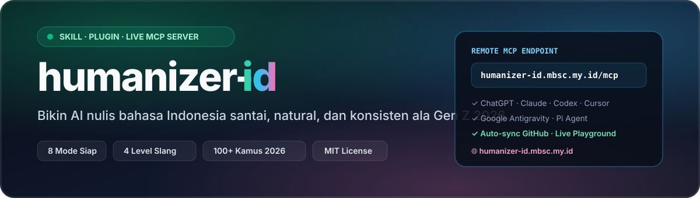

<div align="center">

<a href="https://humanizer-id.mbsc.my.id">
  
</a>

<br><br>

**Skill, Plugin & Hosted Remote MCP Server multifungsi — buat cerita/Wattpad, humanize teks AI, sosmed, copywriting, chatbot/CS, balas chat, artikel, sampai terjemahan gaul.**

<p>
  <a href="https://humanizer-id.mbsc.my.id"></a>
  <a href="https://github.com/diasera/humanizer-id/archive/refs/heads/main.zip"></a>
  <a href="#-sponsor--support"></a>
</p>

<p>
  <a href="LICENSE"></a>
  
  
  
  
  <a href="CONTRIBUTING.md"></a>
</p>

<p>
  <a href="#-lihat-bedanya">Lihat Bedanya</a> •
  <a href="#-live-hosted-mcp-server">MCP Server</a> •
  <a href="#-fitur-utama">Fitur</a> •
  <a href="#-8-mode-siap-pakai">8 Mode</a> •
  <a href="#-cara-pakai">Cara Pakai</a> •
  <a href="#-contoh-prompt">Prompt</a> •
  <a href="#-sponsor--support">Sponsor</a> •
  <a href="#-lisensi">Lisensi</a>
</p>

</div>

---

> [!TIP]
> **⚡ Coba langsung di browser tanpa install apa-apa!**
> - 🌐 **Website & Live Playground:** **[humanizer-id.mbsc.my.id](https://humanizer-id.mbsc.my.id)** *(langsung tes Cek Konsistensi & Kamus Slang real-time!)*
> - 🔌 **Remote MCP Endpoint:** `https://humanizer-id.mbsc.my.id/mcp`
> - 📦 **Download ZIP siap upload:** **[humanizer-id (main.zip)](https://github.com/diasera/humanizer-id/archive/refs/heads/main.zip)**

---

## 🤔 Kenapa `humanizer-id`?

Pernah nyuruh AI nulis teks bahasa Indonesia terus hasilnya kayak gini?

> *"Dalam era digital yang terus berkembang pesat ini, penting bagi kita untuk memahami bahwa manajemen waktu merupakan kunci utama kesuksesan."*

Kaku. Lebay. Kerasa banget tulisan robotnya. 😮‍💨

**`humanizer-id`** ngajarin AI (ChatGPT, Claude, Gemini, Codex, Cursor, Antigravity, Pi, dll) buat nulis kayak **anak muda Indonesia umur 20–25 tahun yang lagi ngobrol** — santai, nggak alay, peka konteks, dan yang paling penting: **gayanya konsisten dari awal sampai akhir.**

Bukan cuma buat satu hal: **1 inti aturan, 8 mode penulisan, 4 level slang, plus Live Remote MCP Server** yang selalu otomatis sinkron sama update terbaru repo ini.

---

## 👀 Lihat Bedanya

### 1. Mode Humanizer (Teks AI Kaku → Natural)

<table>
<tr>
<th width="50%">❌ Sebelum (kerasa AI banget)</th>
<th width="50%">✅ Sesudah (<code>humanizer-id</code> level 1)</th>
</tr>
<tr>
<td valign="top">

Dalam era digital yang terus berkembang pesat ini, penting bagi kita untuk memahami bahwa manajemen waktu merupakan kunci utama dalam mencapai produktivitas yang optimal. Dengan menerapkan strategi yang tepat, kita dapat menyelesaikan berbagai tugas secara efisien dan efektif.

</td>
<td valign="top">

Kalau waktu kamu berantakan, kerjaan ikut berantakan. Makanya ngatur waktu itu penting banget. Tentuin dulu mana yang paling mendesak, kerjain satu-satu, dan sisain waktu buat istirahat.

</td>
</tr>
</table>

### 2. Mode Cerita / Wattpad / Novel

<table>
<tr>
<th width="50%">❌ Sebelum (kaku & klise)</th>
<th width="50%">✅ Sesudah (<code>humanizer-id</code> level 2)</th>
</tr>
<tr>
<td valign="top">

Pagi itu, aku terbangun dengan perasaan yang tidak menentu. Matahari bersinar dengan cerahnya, namun hatiku diselimuti oleh mendung yang kelabu. Aku sangat merindukan dirinya yang telah pergi meninggalkanku.

</td>
<td valign="top">

Gue bangun jam sepuluh, dan hal pertama yang gue lakuin adalah ngecek HP.

Nggak ada chat dari dia. Lagi.

Gue lempar HP ke kasur, terus narik selimut sampai nutup muka. Di luar cerah banget, kayak semesta lagi ngeledek. *Iya, iya, cuma gue doang yang gamon di sini.*

</td>
</tr>
</table>

### 3. Mode Chatbot / Customer Service (Level 0 — Santai Sopan)

<table>
<tr>
<th width="50%">❌ Sebelum (robotik kaku)</th>
<th width="50%">✅ Sesudah (<code>humanizer-id</code> level 0)</th>
</tr>
<tr>
<td valign="top">

Mohon maaf atas ketidaknyamanan yang Anda alami. Kami akan segera menindaklanjuti kendala keterlambatan pengiriman paket Anda sesuai dengan prosedur yang berlaku.

</td>
<td valign="top">

Maaf banget ya Kak paketnya telat nyampe. Boleh kirim nomor pesanannya dulu? Aku bantu cek langsung ke ekspedisinya sekarang.

</td>
</tr>
</table>

---

## 🔌 Live Hosted MCP Server

**`humanizer-id` support MCP (Model Context Protocol)!** Kamu bisa langsung pakai server MCP publik kami tanpa perlu download file, tanpa ribet setup, dan **selalu otomatis dapet update `.md` & kamus slang terbaru** dari GitHub:

| Info | Detail |
|---|---|
| **Endpoint MCP** | `https://humanizer-id.mbsc.my.id/mcp` |
| **Transport** | Streamable HTTP (stateless) |
| **Autentikasi** | Tanpa auth (publik & gratis dipakai) |
| **Privasi & Keamanan** | [`https://humanizer-id.mbsc.my.id/privacy`](https://humanizer-id.mbsc.my.id/privacy) *(read-only, teks nggak disimpan/dicatat ke log)* |
| **Status / Health** | [`https://humanizer-id.mbsc.my.id/health`](https://humanizer-id.mbsc.my.id/health) |

### 🧰 Tools MCP yang Tersedia

| Tool | Fungsi |
|---|---|
| `get_core_rules` | Ambil panduan inti `SKILL.md` versi terbaru (Tone Lock, ejaan terkunci, level slang, anti-pattern) |
| `list_modes` | Lihat semua mode yang tersedia (otomatis mendeteksi mode baru) |
| `get_mode` | Ambil aturan lengkap mode tertentu + inti `SKILL.md` dalam sekali panggil |
| `get_slang_dictionary` | Ambil atau cari kata tertentu di kamus slang & singkatan Gen Z 2026 |
| `check_consistency` | Cek otomatis campuran `nggak`/`gak`/`tidak`, `udah`/`sudah`, frasa klise AI, slang basi, dan singkatan nyasar |

*(Juga menyediakan MCP Resources `humanizer-id://skill`, `humanizer-id://kamus-slang`, `humanizer-id://mode/{name}` dan MCP Prompts `humanize_teks` & `tulis_gaya_genz`.)*

### ⚡ Cara Sambungin MCP

#### ChatGPT Web (`chatgpt.com/plugins`)
1. Buka **Plugins** (`chatgpt.com/plugins`) → klik **Tambahkan** → **Tambahkan server MCP kustom** *(atau lewat **Settings → Apps & Connectors → Developer Mode**)*.
2. Masukin URL:
   ```text
   https://humanizer-id.mbsc.my.id/mcp
   ```
3. Tipe: **Streamable HTTP** · Autentikasi: **None** → **Simpan**.

#### Claude Code
```bash
claude mcp add --transport http humanizer-id https://humanizer-id.mbsc.my.id/mcp
```

#### Google Antigravity / Cursor / Claude Desktop / Client MCP lain
Tambahin ke file konfigurasi MCP kamu:
```json
{
  "mcpServers": {
    "humanizer-id": {
      "url": "https://humanizer-id.mbsc.my.id/mcp"
    }
  }
}
```

---

## ✨ Fitur Utama

| | Fitur | Penjelasan |
|---|---|---|
| 🔌 | **Hosted MCP + Plugin + Skill** | Bisa dipakai lewat Remote MCP (`humanizer-id.mbsc.my.id/mcp`), upload `main.zip`, atau CLI di berbagai platform AI. |
| 🧩 | **8 Mode Penulisan** | Cerita, humanizer, sosmed, copywriting, chatbot, chat harian, artikel, terjemahan — tiap mode punya aturan & checklist sendiri. |
| 🔒 | **Tone Lock** | Kartu gaya (kata ganti, level slang, ejaan, emoji) yang dikunci dari awal biar nggak berubah-ubah di tengah jalan. |
| 🎚️ | **4 Level Slang (0–3)** | Dari *Santai Sopan* (CS/klien/atasan) sampai *Full Gen Z* — otomatis turun saat bahas topik serius. |
| 📖 | **Kamus Slang 2026** | 100+ istilah + singkatan chat dengan label umur kata (🟢 evergreen, 🟡 umum, 🔴 tren, ⚫ kasar). |
| 🫶 | **Peka Konteks** | Duka, komplain, urusan duit, atau ngomong ke atasan? Slang otomatis diturunin, nol bercanda. |
| 🚫 | **Anti-Pattern AI** | Daftar frasa klise "AI banget" (fiksi & non-fiksi) lengkap sama cara gantinya. |
| ✅ | **Auto-Check Konsistensi** | Checklist per mode + tool MCP `check_consistency` buat ngecek hasil tulisan. |
| 🤖 | **Multi-Agent Ready** | Peran penulis, editor gaya, reviewer konsistensi, dan aturan prioritas yang jelas. |

---

## 🧩 8 Mode Siap Pakai

| Mode | Buat apa | Level Default | File | Contoh Pemakaian |
|---|---|---:|---|---|
| 📚 **Cerita** | Novel, Wattpad, cerbung, fanfic, AU | `2` | [cerita.md](modes/cerita.md) | *"Tulis bab 1 romcom kampus, POV gue."* |
| 🧑‍💻 **Humanizer** | Ubah teks kaku/kerasa AI jadi natural | `1` | [humanizer.md](modes/humanizer.md) | *"Ubah paragraf ini biar nggak kaku."* |
| 📱 **Sosmed** | Caption IG/TikTok, thread, script video | `2` | [sosmed.md](modes/sosmed.md) | *"Bikin caption buat kafe baru di Bandung."* |
| 🛍️ **Copywriting** | Iklan, promo, deskripsi produk, push notif | `1` | [copywriting.md](modes/copywriting.md) | *"Deskripsi tas ransel buat marketplace."* |
| 🤖 **Chatbot / CS** | Persona chatbot dan customer service | `0–1` | [chatbot.md](modes/chatbot.md) | *"Bikin persona CS ramah buat toko skincare."* |
| 💬 **Chat Harian** | Balas WA, DM, komen netizen | `mirror` | [chat-harian.md](modes/chat-harian.md) | *"Bantuin nolak ajakan nongki dengan halus."* |
| 📰 **Artikel** | Blog, artikel, newsletter | `1` | [artikel.md](modes/artikel.md) | *"Artikel tips hemat anak kos 600 kata."* |
| 🌐 **Terjemahan** | Teks baku / Inggris → bahasa gaul | `2` | [terjemahan.md](modes/terjemahan.md) | *"Terjemahin dialog film ini jadi gaul."* |

### 🎚️ 4 Level Slang

| Level | Nama | Cocok Buat | Contoh Rasa |
|---:|---|---|---|
| **0** | Santai Sopan | CS, klien, dosen, atasan, ortu, topik sensitif | *"Maaf ya Kak, aku bantu cek sekarang."* |
| **1** | Santai Ringan | Artikel, copywriting, humanizer, romance kalem | *"Kalau waktunya berantakan, kerjaan ikut keteteran."* |
| **2** | Gaul Natural ⭐ | Sosmed, Wattpad, romcom, chat temen | *"Jujur aja, vibes-nya udah red flag sih."* |
| **3** | Full Gen Z | Komedi chaos, AU/chat, komunitas anak muda | *"Anjir dia bales oke doang gue udah delulu."* |

Aturan inti ada di [SKILL.md](SKILL.md), kamus lengkap & singkatan ada di [references/kamus-slang.md](references/kamus-slang.md).

---

## 🚀 Cara Pakai

Selain pakai **[Live Hosted MCP Server](#-live-hosted-mcp-server)** (`https://humanizer-id.mbsc.my.id/mcp`), kamu juga bisa pasang sebagai **Plugin** atau **Skill lokal**:

<details open>
<summary><b>📦 Download ZIP langsung (ChatGPT Plugins / Skills, Claude.ai / Desktop)</b></summary>

<br>

1. Download ZIP langsung dari GitHub: 👉 **[humanizer-id (main.zip)](https://github.com/diasera/humanizer-id/archive/refs/heads/main.zip)**
2. Langsung upload file `.zip` itu ke menu **Plugins** atau **Skills** di ChatGPT / Claude. Karena `SKILL.md`, `modes/`, `references/`, dan `.claude-plugin/plugin.json` ada di root repo, semuanya otomatis kebaca.

</details>

<details>
<summary><b>⚡ Claude Code (Plugin Marketplace)</b></summary>

<br>

```bash
/plugin marketplace add diasera/humanizer-id
/plugin install humanizer-id@humanizer-id
```

</details>

<details>
<summary><b>🛠️ Skills CLI (Codex, Claude Code, Cursor, Antigravity, semua agent)</b></summary>

<br>

```bash
npx skills add diasera/humanizer-id
```

Atau install global ke semua agent yang terdeteksi:

```bash
npx skills add diasera/humanizer-id --global --agent '*'
```

</details>

<details>
<summary><b>🪐 Google Antigravity / Cursor / Pi / Custom GPT & Gems</b></summary>

<br>

- **Google Antigravity:**
  ```bash
  git clone https://github.com/diasera/humanizer-id.git .agents/skills/humanizer-id
  ```
- **Cursor:** Repo ini udah dilengkapi `.cursor-plugin/plugin.json` yang langsung baca `SKILL.md` di root.
- **Pi coding agent:**
  ```bash
  pi install git:github.com/diasera/humanizer-id
  ```
- **Custom GPT / Gemini Gems / Claude Projects:** Download & ekstrak ZIP, lalu upload `SKILL.md`, semua file di `modes/`, dan `references/kamus-slang.md` sebagai **knowledge file**.

> [!IMPORTANT]
> Kalau pasang manual, pastiin folder `modes/` dan `references/` selalu ikut bareng `SKILL.md`.

</details>

---

## 💡 Contoh Prompt

```text
[Cerita] Pakai humanizer-id. Tulis bab 1 cerita romcom kampus, POV gue,
enemies to lovers, level slang 2, sekitar 1.500 kata.
```

```text
[Humanizer] Pakai humanizer-id. Ubah teks ini biar nggak kaku dan nggak
kerasa AI, jangan ubah faktanya: [tempel teks]
```

```text
[Sosmed] Pakai humanizer-id. Bikin caption IG buat kafe baru buka di
Bandung, tone santai, ada CTA, 4 hashtag.
```

```text
[Copywriting] Pakai humanizer-id. Tulis deskripsi produk tas ransel anti
air 20 liter buat marketplace, tone santai tapi tetap jujur.
```

```text
[Chatbot] Pakai humanizer-id. Bikin persona chatbot CS toko skincare:
ramah, panggil user "Kak", dan tau kapan harus serius.
```

```text
[Chat harian] Pakai humanizer-id. Bantuin bales chat temen yang ngajak
nongki malam ini, padahal gue capek. Kasih 3 opsi.
```

```text
[Artikel] Pakai humanizer-id. Tulis artikel blog 600 kata soal tips hemat
anak kos, gaya santai tapi informatif.
```

```text
[Terjemahan] Pakai humanizer-id. Terjemahin teks ini ke bahasa Indonesia
gaul (level 2), nama dan angka jangan berubah: [tempel teks]
```

---

## 📂 Struktur Repo

<details>
<summary><b>Klik buat liat struktur folder & daftar isi <code>SKILL.md</code></b></summary>

```text
humanizer-id/
├── SKILL.md                          # inti skill + pilih mode (source of truth)
├── modes/
│   ├── cerita.md                     # novel, Wattpad, fanfic
│   ├── humanizer.md                  # ubah teks kaku/AI jadi natural
│   ├── sosmed.md                     # caption, thread, script video
│   ├── copywriting.md                # iklan, promo, deskripsi produk
│   ├── chatbot.md                    # persona chatbot / CS
│   ├── chat-harian.md                # balas WA, DM, komen
│   ├── artikel.md                    # blog, artikel, newsletter
│   └── terjemahan.md                 # baku/Inggris → gaul
├── references/
│   └── kamus-slang.md                # kamus slang dan singkatan 2026
├── .claude-plugin/
│   ├── plugin.json                   # manifest plugin (Claude Code & ChatGPT)
│   └── marketplace.json              # marketplace Claude Code
├── .cursor-plugin/
│   └── plugin.json                   # manifest plugin Cursor
├── agents/
│   └── openai.yaml                   # metadata OpenAI / Codex
├── assets/
│   └── banner.svg                    # banner repo GitHub
├── package.json                      # manifest paket Pi
├── README.md                         # yang lagi kamu baca
├── CONTRIBUTING.md                   # cara nambah slang / mode
├── CHANGELOG.md                      # riwayat versi
└── LICENSE                           # MIT
```

**Daftar isi `SKILL.md`:**
1. Cara Kerja · 2. Pilih Mode · 3. Aturan Emas · 4. Tone Lock · 5. Level Slang · 6. Ejaan Santai yang Udah Dikunci · 7. Partikel Bahasa Lisan · 8. Campur Bahasa Inggris · 9. Kamus Slang dan Singkatan · 10. Peka Konteks · 11. Anti-Pattern Umum · 12. Checklist Umum · 13. Kerja Bareng Banyak Agent

</details>

---

## 💖 Sponsor & Support

`humanizer-id` — termasuk **Live Hosted MCP Server** di `humanizer-id.mbsc.my.id` — dibikin gratis dan open-source (MIT) biar bisa dipakai siapa aja, termasuk buat proyek komersial.

Kalau proyek ini ngebantu kerjaan, konten, atau bisnis kamu, kamu bisa ikut dukung keberlanjutan server & update kamus slang-nya:

| Jalur Dukungan | Yang Kamu Dapat |
|---|---|
| ⭐ **Star & Share** *(Gratis)* | Bantu makin banyak kreator & developer Indonesia nemu repo ini! |
| ☕ **Individual Supporter** | Nama / link GitHub kamu tampil di daftar pendukung & bantu biaya domain + maintenance MCP server. |
| 🚀 **Brand / Commercial Sponsor** | Logo & link brand tampil di bagian atas README, prioritas request mode / kamus baru, dan bisa diskusi setup dedicated MCP / custom brand voice buat tim kamu. |

### 🏆 Sponsors

<div align="center">

*Belum ada sponsor — **jadi sponsor pertama `humanizer-id`!** ✨*

Tertarik jadi sponsor, kolaborasi, atau butuh custom brand voice / dedicated MCP buat bisnis kamu?<br>
**[📩 Hubungi lewat GitHub Issues](https://github.com/diasera/humanizer-id/issues/new?title=Sponsorship%20%2F%20Kolaborasi%20humanizer-id)**

</div>

---

## 🤝 Kontribusi

Slang itu cepet banget berubah. Kalau nemu istilah baru, arti yang kurang pas, slang yang udah basi, atau mau nambah mode baru, **PR dan issue sangat diterima!**

Baca dulu [CONTRIBUTING.md](CONTRIBUTING.md) biar formatnya seragam.

---

## ⚠️ Disclaimer

- Slang berlabel 🔴 **tren** gampang basi. Cek ulang sebelum dipakai buat konten jangka panjang.
- Beberapa istilah berlabel ⚫ bersifat **kasar/peyoratif**. Istilah itu dicantumin cuma buat kebutuhan karakter fiksi, bukan buat ngehina siapa pun.
- Arti slang dikumpulin dari pemakaian sehari-hari dan sumber publik (artikel gaya hidup, media sosial). Pemakaian bisa beda-beda tiap daerah dan circle.
- **Etika humanizer:** skill ini buat bikin tulisan enak dibaca, **bukan** buat nyontek tugas akademik atau ngaku tulisan orang lain sebagai karya sendiri. Skill ini juga **nggak menjamin** tulisan lolos AI detector.
- **Privasi MCP:** semua 5 tool MCP bersifat read-only dan teks yang dicek di `check_consistency` diproses di memori saja (nggak disimpan & nggak dicatat ke log). Meski begitu, **jangan kirim data rahasia** (password, OTP, KTP, data klien) ke server MCP publik — untuk data sensitif / *Zero Data Retention*, pakai mode lokal (`main.zip` / `npx skills add`). Detail lengkap ada di [Privasi & Keamanan](https://humanizer-id.mbsc.my.id/privacy).
- Skill ini buat teks santai. Jangan dipakai buat dokumen hukum, medis, atau akademik formal.

---

## 📄 Lisensi

Dirilis dengan lisensi **[MIT](LICENSE)** © 2026 diasera.

Artinya kamu **bebas** pakai, ubah, gabungin, publikasi, distribusi, sublisensi, bahkan **jual** — buat proyek pribadi maupun **komersial**. Syaratnya cuma satu: **cantumin file `LICENSE` / copyright notice** di salinan kamu.

<div align="center">

---

Kalau `humanizer-id` kepake, jangan lupa kasih ⭐ di atas ya!

**Gas nulis! ✍️**

</div>
